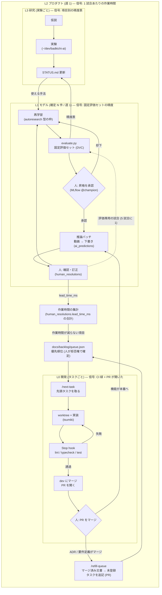

# ADR-020: AI 先行入力への転換とループエンジニアリング

## ステータス
Accepted (2026-11-23)。未決事項 1 は 2026-11-23 に作者が「課金は一旦置き、AI 化とループを進める」と決定し解消。
同日、`docs/research/loop-engineering/survey.md` の調査結果で §2 / §3 / §4 / §5 を改訂 (改訂箇所は「改訂 2026-11-23」と記す)。

## 背景

### 入力時間が顧客数の上限を決めている

1 試合 (42 分の動画、112 ラリー、720 打) の入力は、打点パスを除いた実測で動画の 3.3 倍、
含めると作者の実感で 4 〜 5 倍かかる (`docs/research/input-automation/analysis.md` §1)。
運営が代行に使える時間は月 8 時間で、入力できるのは月 2 〜 3 試合にとどまる。
人手のパスを磨く案 (バックログ エピック C) を全部入れても、見積は 144 〜 171 分で、
3.3 倍が 2 倍台に下がる程度にしかならない (同 §4 段階 1)。
作業時間を 3 分の 1 にするには、人が「入力する」のをやめて「直す」だけにするしかない。

### 検証で、項目ごとの精度の見通しがついた

`~/dev/badkichi-ai/STATUS.md` (2026-11-02 時点) の結果。南区 = 横から床置きの映像 (正解 720 打)、
戸塚 = ベースライン後方 120 cm の映像 (アプリの打刻が正解)。

| 項目 | 現状の精度 | 学習の要否 |
|---|---|---|
| ラリー開始 (サーブ時刻) | 戸塚 20/23 (±1 秒)、余分 6 (静止 + 姿勢分類器の和集合) | 分類器は 100 サーブで学習済み |
| サーブ側 / サーバー / 左右 | 構えの配置からの 4 択分類器で側 97% / 左右 94% | 同上 |
| 打刻 (ショット時刻) | ラリー区間が既知なら音 + 映像の融合で再現 81% / 適合 81%、誤差 50 〜 60 ms | 音のピーク分類器は学習済み |
| 打者 | 打刻が合えば姿勢から決まる。追跡が外れる区間は不可 | 不要 |
| 球種 | 候補に正解 86.8%、1 位 54 〜 64% (打点・行き先・間隔・直前の球種) | 自前の注釈で分類器を学習 |
| 打点の座標 | ホモグラフィ第 1 版。正解がなく未検証。奥は 5 px ≈ 0.7 m | 不要 |
| ラリー終了 | 戸塚 ±2 秒で 8/13 | — |
| シャトルの追跡 | 公開 TrackNetV3 は可視率 26%。仮ラベルでの微調整は 2 回とも改善せず | 人手ラベル数百〜数千フレームが要る |

精度は項目ごとにばらつくが、どの項目も「人がゼロから入力する」より「下書きを直す」方が速い水準に
近づいている。足りないのは精度そのものより、精度を上げるためのデータ (人の訂正) が流れる仕組みである。

### 既存の決定が「人手が先、AI は後」の前提で書かれている

| ADR | 現在の記述 | 本 ADR での扱い |
|---|---|---|
| ADR-013 §6-2 | ブラウザ内推論、またはクライアントで特徴量だけ抽出して送るハイブリッド | §7 で読み替え (当面は運営のバッチ) |
| ADR-016 / 018 | AI 推論 (ADR-017 Stage 1 以降) への投資は第 2 ゲート通過後 | §8 で読み替え (AI を本線に繰り上げ) |
| ADR-017 §2 | Stage 2 (打点検出) → 3 (打者) → 4 (球種) の階段 | §1 で順序を検証結果に合わせて置き換え |
| ADR-017 §3 | ライブ記録 UI は聖域 | 残すが本線から外す (§1) |
| ADR-018 §2 | YouTube 限定公開 URL のみ。動画ファイルは受け取らない | §6 で読み替え (原本を受け取る) |

### 開発の進め方も人のプロンプト主導のまま

ADR-003 で Phase 0 (tsumiki + permissions + learning-rules) を入れたが、タスクの選択、実装、検証、
PR 作成はすべて作者が 1 回ずつ指示している。AI 下書きとモデル改善を回すには、開発とモデル学習の
両方を「人が起点にならなくても回る」形にする必要がある。

### 作者の判断 (2026-11-13)

1. 記録のすべての項目を AI の下書きにし、人は訂正だけを行う形に転換する。精度が低い項目も待たずに出す。
2. 人の訂正から正解データを得て、モデルを自動で改善するループを作る。
3. 開発そのものもループで自律的に回す。ハーネスが足りなければ整備する。

## 決定

### 1. 入力モデルの転換: 全項目を AI の下書きにし、人は訂正だけ行う

記録と注釈の全項目を対象にする。下書きの出し方は現時点で精度が出ている手法から入れ、
順序は ADR-017 の階段 (打点検出が先) ではなく、**検証で精度が出ている順** にする。

| 順 | 項目 | 下書きの出し方 (現時点) | 人の操作 |
|---|---|---|---|
| 1 | ラリー開始・サーブ側・サーバー・左右 | 静止検出 + 姿勢分類器 + 配置分類器 | 余分な候補の削除、見逃しの追加 |
| 2 | 打刻 | ラリー区間内の音 + 映像の融合 | 漏れの追加、偽の削除。時刻のナッジは原則不要 (誤差 60 ms) |
| 3 | 打者 | 打刻時刻の手首位置と人物追跡 | 違うものだけキーで入れ替え |
| 4 | 得点者 | 未着手。ラリー終了時の動きか、人の 1 タップ | 1 タップ (当面は人の入力項目) |
| 5 | 球種 | 打点・行き先・間隔・直前の球種からの分類器 | 流して見て違うものだけ直す |
| 6 | 打点の座標 | 打者の足元 + コートの校正 (ホモグラフィ) | ずれたものだけドラッグ |
| 7 | ラリー終了・決まり方・落下点 | 打球候補の塊の末尾を初期位置に。決まり方は未着手 | コマ送りで確定、決まり方は選択 |

原則:

- **精度を待たない。** 下書きは精度に関わらず出す。精度の低い項目は「人が入力する」のではなく
  「人が直す」。直し方が新規入力より遅い項目があれば、それは UX の問題として直す。
- **直す方が速い UX を条件にする。** ラリー単位の全却下、1 キーでの確定、訂正は 1 ショット 5 秒以内、
  を確認画面 (BL-034) の受け入れ条件にする。この条件を満たせない項目は、満たすまで下書きを出さない。
- **ライブ記録 UI は残すが本線から外す。** ADR-017 §3 の「聖域」は維持する (手を入れない) が、
  位置づけは「動画ファイルがない試合」と「AI が使えないとき」のフォールバックに変わる。
- **既存の注釈スタジオは確認画面に統合する。** 3 パス (決まり方 / 種別 / 打点) は、下書きが揃った後は
  1 回の確認パスにまとめる (`analysis.md` §3-3)。パス単位の画面は下書きが揃うまでの経過措置。

### 2. 予測と人の確定を二層で持ち、確認も訂正も記録する (改訂 2026-11-23)

学習に使えるのは「人が見た」データだけである。人は気づいたところしか直さないので、
**未変更の下書きを正解とは扱わない**。

当初案は shots の項目ごとに draft / confirmed / corrected の 3 状態を持つ形だったが、調査
(`docs/research/loop-engineering/survey.md` §4-3) で Label Studio の「予測は読み取り専用、人の注釈は
元予測を参照する別の行」というスキーマを採り、Supabase に写す形に改める。

- **`ai_predictions`**: AI が出した値。shot_id (または rally_id)、field、value、ai_model_version、score、
  input_hash、created_at。**追記のみ、更新しない**。既存の `annotation_source` / `ai_model_version` /
  `ai_confidence` 列は、この表の「現在採用している予測」を shots に写した値として残す。
- **`human_resolutions`**: 人の確定。prediction_id (元予測、人が新規に入力した場合は null)、field、value、
  kind = `confirmed` / `corrected` / `rejected`、lead_time_ms (その項目に人が使った時間)、user_id、created_at。
  **追記のみ**。
- shots / rallies の列は「現在の値」を持つだけにし、履歴は上の 2 表から復元する。
- 確認 (`confirmed`) も記録する。確認は「この値は正しい」という正例で、訂正と同じ価値がある。
  ラリー単位の一括確認は、そのラリーの全項目に `confirmed` を書く。
- 統計では、人の確定が無い予測を「未確認」として表示し、各チャートに未確認の割合を出す。
- 学習に使うのは `human_resolutions` のある項目だけ。確定の無い予測は使わない。
- `lead_time_ms` の合計が「1 試合あたりの作業時間」(BL-020) になる。計測機能を別に作らない。

ADR-017 §5 の `shot_corrections` はこの二層に置き換える (同じ目的で情報が増える)。

### 3. 評価の正本は凍結した評価セット。訂正データでは評価しない

訂正データは「人が直しやすい場面」に偏る。評価は訂正データとは別の、凍結したセットで行う。

- **固定評価セット**: 南区セット 3 (281 打 / 37 ラリー、正解あり) と戸塚 (サーブ 23 本、
  フレーム精度の打刻 40 打) を凍結する。学習には使わない。以後、撮影ガイド (BL-008) の条件で撮った
  映像が揃ったらセットを追加するが、既存のセットは差し替えない。
- **項目ごとの指標と許容誤差**を決める (案。要件定義で確定):

| 項目 | 指標 | 許容誤差 |
|---|---|---|
| ラリー開始 | 再現率 / 余分な候補の数 | ±1 秒 |
| サーブ側 / サーバー / 左右 | 正解率 | — |
| 打刻 | 再現率 / 適合率 / 時刻誤差の中央値 | ±0.25 秒 |
| 打者 | 正解率 (4 択) | — |
| 球種 | 1 位正解率 / 候補内正解率 | — |
| 打点 | 誤差の中央値 (m) | 0.5 m |
| ラリー終了 | 再現率 | ±2 秒 |

- **昇格の条件**: 固定評価セットで前の版を下回る項目がない、かつ直近の訂正率が下がっている。
  どちらかを欠けば昇格しない。
- 評価は 1 コマンドで項目ごとの表を出す。`~/dev/badkichi-ai/` の `eval_*.py` を束ねる。
  結果は `STATUS.md` の表に追記する形で残す。
- **評価セットの増やし方 (追記 2026-11-23)**: 人の確定データ (`human_resolutions`) から評価セットに回す場合は
  **試合単位で分ける**。たとえば 5 試合に 1 試合を評価専用にし、その試合の確定データは学習に一切使わない。
  同じ試合のショットが学習と評価の両方に入ると精度が実力より高く出るため、ショット単位やラリー単位では分けない。
  評価専用の試合は `matches` に印を付け、再学習の書き出しで除外する。
  評価セットを増やしたら新しい版にし、champion を新しい版で評価し直して基準値を置く。版をまたいだ精度の比較はしない。
- (改訂 2026-11-23) 固定評価セットは **DVC** でバージョンを凍結し、学習スクリプトから読めないパスに置く。
  評価結果と学習済みモデルは **MLflow** (SQLite バックエンド) に記録し、昇格は `@champion` / `@challenger`
  のエイリアス付け替えで行う。gold set の可視化とモデル間比較には FiftyOne を使う。
  いずれも一人で運用できる最小構成として選んだ (survey §4-4)。

### 4. 4 層のループと、人が残る 3 点

ループは「閉じた計測信号」があるものだけを自律化する。信号のないループは自律化しない。

| 層 | ループ | 信号 | 周期 | 人が残る点 |
|---|---|---|---|---|
| L0 開発 | タスク取得 → 実装 → lint / typecheck / test → PR | CI の緑、PR のマージ | タスクごと | **PR のマージ** |
| L1 モデル | 下書き → 訂正 → 再学習 → 固定セットで評価 → 昇格 | 固定セットの精度、訂正率 | 訂正 N 件ごと、または週 1 | **昇格の承認** (初期のみ。安定したら自動) |
| L2 プロダクト | 文書のマージ → キューの補充案 / 作業時間の計測 → 並べ替え案 | 1 試合あたりの作業時間 (BL-020)、未登録の決定事項 | 文書のマージごと、週 1 | 補充 PR で行を消す・並べ替える (拒否権) |
| L3 研究 | 仮説 → 実験 → `STATUS.md` 更新 | 項目ごとの精度表 | 実験ごと | 次の仮説の選択 |

L2 を外側の統治役に置く。L0 と L1 の成果はすべて「作業時間が減ったか」で判定する。

#### ループの図 (追記 2026-11-23)

矢印 = 成果物や信号の受け渡し。ひし形 = 人が判断する点 (3 つ)。

読み方:

- **L0 と L1 は独立に回る。** つなぐのは「L0 が作った機能で L1 の下書きと訂正が動く」(E → F) と、
  「L1 の訂正時間が L2 の信号になる」(G → T) の 2 本だけ。
- **L2 が親。** 作業時間が減らない項目があれば、キューの先頭にその項目の改善タスクが来る (T → Q → A)。
  文書がマージされるたびに `/refill-queue` が未登録のタスクを補充する (E → R → Q)。人は補充 PR で消す・並べ替えるだけ。
- **L3 は L1 の供給源。** 実験で使えると分かった手法だけが再学習の枠に入る (M → H)。評価結果は STATUS.md に戻る (I → M)。
- 人の確定の一部 (5 試合に 1 試合) は学習に使わず評価セットに回る (G ⇢ I、§3)。

**L0 のハーネス** (ADR-003 Phase 1 への移行。移行条件を「痛みの観測」から「方針判断」に改める。改訂 2026-11-23):

- `settings.json` の Stop hook で、コードに変更があれば lint / typecheck / test を回し、失敗したら終わらせない。
  連続ブロックの上限は Claude Code 組み込みの 8 回に任せる。PostToolUse で編集した .ts / .vue を eslint にかける。
- タスクキューは **JSON** (`docs/backlog/queue.json`)。公式の長時間エージェント指針に従い、ループが変えてよいのは
  `passes` / `pr` / `notes` だけ、行の削除は禁止、追加は末尾。人は順序を並べ替えて優先度を伝える。
- 1 周 1 タスク。`/next-task` が先頭の未完了タスクを取り、worktree を切り、実装し、dev にマージし、PR を開いて止まる。
  **完了の判定はモデルの発話ではなく「PR が開いた」という外部事実**で行い、PR 番号を `pr` に書く。
- 各周の学び (詰まった点、次の周への注意) を `docs/backlog/progress.md` に追記する。次の周は最初にこれを読む。
- 試行がうまくいかない周は、キューの `notes` に理由を書いて人に保留 (needs-human) し、次のタスクには進まない。
- 起点は**まずローカルの `/next-task`** で 5 周回す。安定したら `claude-code-action` の cron (1 run 1 タスク、
  `--max-turns`、`timeout-minutes`、`concurrency: 1`) に移し、検証は既存 CI に任せる。秘密は Environment Secrets のまま。
- PR の本文はテンプレート (`.github/pull_request_template.md`) に従い、対応タスク、完了条件と結果、検証、
  人が判断することを必ず書く。
- 並列実行 (Agent Teams、ADR-003 Phase 2) は入れない。PR が 1 本ずつ流れれば足りる。
- 既製のループ製品 (Ralph 系、BMAD、spec-kit) は入れない。借りるのは設計だけ (survey §3、§5-1)。

**L1 のハーネス** (改訂 2026-11-23):

- `~/dev/badkichi-ai/` に **autoresearch 型の枠**を作る (survey §4-1): `program.md` (研究方針、人だけが編集)、
  ループが編集できるファイルは 1 つ (特徴量やハイパーパラメータ)、評価器 `evaluate.py` と固定評価セットは不変、
  1 実験に時間上限、結果は `results.tsv` に追記、改善したら git commit で keep、しなければ revert。
  Claude Code はこの枠の中だけで実験を回す。
- 推論は 1 コマンド (`動画 + match_id → 下書き JSON`)。本体には `ai_predictions` への取り込み経路を作る。
- 再学習は 1 コマンド (`human_resolutions を書き出す → 学習 → evaluate.py → MLflow に記録`)。
- 昇格は MLflow の評価結果と前版との差分を人に見せ、承認で `@champion` を付け替える。
- 学習の要らない後処理コード (音 + 映像の打刻融合、ラリー境界の後処理) は **OpenEvolve** (Claude Code CLI を
  バックエンドにできる) で評価器のスコアを目標に進化させる。
- 本体リポジトリとは DB の `ai_predictions` / `human_resolutions` だけで接続する。

**L2 の補充工程 `/refill-queue`** (追記 2026-11-23): ループは `queue.json` にあるタスクしか消費しないので、
文書で決まった機能 (例: 動画の受け取りと保管) をキューに入れる工程が無いと永遠に作られない。
そこで、ADR や要件定義がマージされるたびに `/refill-queue` がそこから未登録の実装タスクを導き、キューの末尾に
追記する PR を開く。人はその PR で要らない行を消し、順序を直してマージするだけ。消費 (L0) と補充 (L2) は信号も
周期も違うので別コマンドにする。

**人が残る点** (改訂 2026-11-23)。原則は「AI が提案し、人は拒否権で決める」。

| # | 場面 | 頻度 | 扱い |
|---|---|---|---|
| 1 | PR のマージ (実装、要件定義、ADR、キュー補充のすべて) | 1 周ごと | 残す。要件定義の確認もここに含める |
| 2 | モデルの昇格の承認 | 再学習ごと | 残す。数回安定したら自動化 |
| 3 | 動画の受領と学習利用の同意 | 顧客・動画ごと | 残す (運用)。同意フォームで定型化 |
| 4 | ADR の Accept と未決事項への回答 | 方針ごと | 残す。該当タスクに来たときに答えればよい |
| 5 | キューの順序と要らない行の削除 | 補充 PR ごと | 拒否権のみ。案は `/refill-queue` が出す |
| 6 | 次の研究の仮説 (L3) | 実験ごと | 拒否権のみ。候補は AI が列挙する |
| 7 | needs-human で保留されたタスクの解消 | 不定期 | 残す |
| 8 | 評価専用の試合の指定 | 試合ごと | 規則 (5 試合に 1) で自動化 |

人にしか出せない判断は 1 〜 4。5 〜 6 は AI の案を眺めて拒否するだけにし、8 は規則にする。
それ以外は人が起点にならなくても回るようにする。

### 5. シャトルの追跡は本線から外し、球種の訂正率で着手を判断する

利用者にフレーム単位の軌跡は入力させられず、仮ラベルでの微調整は改善しなかった (STATUS §C-5)。
次の 2 つの迂回路を取る。

- **追跡なしで下書きを出す。** 打刻は音 + 映像の融合、打者は姿勢、球種は打刻の間隔・打者の位置・
  直前の球種から出す。これらはすべて利用者が訂正できる項目で、訂正がそのまま学習データになる。
- **打刻を弱教師にして後から追跡を育てる。** 人が確定した打刻時刻では、シャトルは打者のラケット付近にある。
  この拘束を TrackNet の損失項か後処理の整合性スコアとして**自前で実装**する (Snorkel は保守が止まっており
  使わない。改訂 2026-11-23)。人手ラベルは追跡が外れた区間だけ足し、座標ラベルが本格的に要る段階になったら
  Label Studio (self-host) と FiftyOne を使う。これは L3 の実験項目で、本線の順序には入れない。

追跡が無いと困るのは球種だけ (打刻は音が主、打者は姿勢、打点は打者の足元)。球種は利用者が直せるが
シャトルの座標は直せないので、まず訂正で育つものから出す。**着手の判断は項目別の訂正率で行う**: 球種の訂正に
かかる時間が 1 試合あたりの作業時間の最大の壁だと数字で分かった時点で、追跡の学習に投資する (追記 2026-11-23)。

### 6. 動画原本を受け取る (ADR-018 §2 の読み替え)

AI の下書きには動画ファイルが要り、YouTube の動画は使えない。

- 代行の依頼では**動画ファイルを受け取る**。受け取り方 (共有リンク、専用アップロード) は
  BL-007 の受け渡し手順で決める。
- 保管は推論と確認が終わるまでとし、それ以降の保持期間と削除の手順は BL-031 の ADR で決める。
- **学習への利用はオプトイン**。同意がない動画は推論にだけ使い、保持するのは数値特徴量
  (シャトル・骨格・コート座標) と訂正のみ (ADR-013 §6-4 と整合)。
- プライバシーポリシー (BL-004) に、受領・保管・削除・学習利用の 4 点を書く。
- (追記 2026-11-23) 本体側の機能として、動画の受け取り、保管と保持期間・削除、学習利用の同意フラグ、保管済み動画への
  推論起動と結果の取り込みが要る。要件定義 `docs/spec/video-intake/` (VID-0) と実装 (VID-1 〜 4) をキューに置いた。

### 7. 推論は当面、運営のバッチで行う (ADR-013 §6-2 の読み替え)

- ブラウザ内推論 (WebGPU) は採らない。M2 で TrackNetV3 が実時間の 13 倍、人物追跡が 2.3 倍で、
  ブラウザ内では成立しない。
- 当面は運営の Mac で夜間バッチ。利用者が自分で動画を投入する段階 (BL-044) になったら
  クラウド GPU のバッチに移す。費用の上限は L2 の作業時間の削減額から決める。
- 「動画でなく特徴量だけを送る」ハイブリッド (ADR-013 §6-2) は、クラウドに移すときの目標として残す。

### 8. バックログの順序を変える (ADR-016 / 018 の読み替え)

- AI 推論への投資は第 2 ゲートを待たない。エピック D (AI による下書き) を最優先に繰り上げる。
- エピック C (人手のまま短縮) は BL-020 (作業時間の自動計測) だけ残し、残りは凍結する。
  BL-021 (動画タップとコートの校正) は、打点の下書き (§1 の 6) の前提として D に移す。
- エピック A (初回販売) は**課金を含めて一旦保留**する (作者決定 2026-11-23)。進行中の 2 組への対応は
  既存機能と口頭の運用で続け、A の中で AI 化の前提になる撮影ガイド (BL-008) とプライバシーポリシーの
  動画受領条項 (BL-004) だけはエピック D 側の依存として扱う。
- バックログ本文の改訂は本 ADR の Accept 後に行う。

## 理由

### なぜ精度を待たずに出すか

精度を上げるデータは訂正からしか来ない。精度 8 割を待ってから出す方式では、8 割に届くまでの
データを運営が人手で入力することになり、それが今の詰まりそのものである。
先に出せば、精度が低い間も「人が入力する時間」が「人が直す時間」に変わり、直す時間は
精度が上がるほど減る。人手のパスを磨いても 2 倍台止まりで、顧客数の上限は変わらない。

### なぜ 3 状態か

「未変更 = 正解」で学習すると、人が見落とした誤りを正解として学習し、同じ誤りが固定される。
`confirmed` を明示的に取ることで、学習データが「人が見た」ものだけになる。
確認の操作 (ラリー単位の一括確認) は訂正と同じ画面に置けば追加の負担は小さい。

### なぜ固定評価セットか

訂正データで評価すると、人が直しやすい場面に偏る上、学習データと評価データが混ざる。
自動で昇格を判定するループでは、評価データの独立性だけが「悪くなったのに昇格する」事故を防ぐ。

### なぜシャトルの追跡を外すか

追跡は「打刻・打者・球種の鍵」(STATUS §C) と見ていたが、打刻は音 + 映像で 81% / 81%、
打者は姿勢で足りることが分かった。追跡が要るのは球種の精度向上だけで、そこは人の訂正で
補える。人手ラベルが数千フレーム要る作業を、精度の出ている項目より先に置く理由がない。

### なぜ 4 層に分けるか

1 本の大きなループにすると、何の信号で止めるかが曖昧になり、自律化が漂流する。
層ごとに信号と周期を分け、外側 (作業時間) が内側を統治する形にすれば、
内側のループがいくら回っても、作業時間が減らなければ外側で止まる。

### データエンジニアのアナロジー

- **訂正の記録 = CDC (変更データキャプチャ) のログ**: 上書きでなく差分を残すから、後から学習データを再構成できる
- **固定評価セット = 回帰テストのゴールデンデータ**: 入力を凍結しないと、パイプラインの改善と劣化を区別できない
- **昇格 = blue / green デプロイ**: 新しい版を並行で評価し、指標が落ちなければ切り替える
- **4 層のループ = DAG のスケジューラと SLA**: 内側のジョブは外側の SLA (作業時間) で監視される
- **未変更 ≠ 正解 = NULL と空文字の区別**: 「値がない」と「値が空であることを確認した」は別の状態

## 影響

### 次のアクション (順序、改訂 2026-11-23)

1. **L0 / L2 のハーネス**: Stop / PostToolUse hook、JSON キュー、`progress.md`、`/next-task` (消費)、`/refill-queue` (補充)、PR テンプレート。
   ADR-003 の Phase 1 として記録する。ローカルで 5 周回してから GitHub Actions の cron へ。
2. **要件定義 `docs/spec/ai-draft-loop/`**: 二層スキーマ (§2)、確認画面の受け入れ条件 (§1)、固定評価セットの
   書き出し、`ai_model_version` の切り替え、`lead_time_ms` の計測。ここまでは動画がなくても進む。
3. **`~/dev/badkichi-ai/` に autoresearch 型の枠と `evaluate.py`** (§4 L1)。固定評価セットを DVC で凍結し、MLflow を入れる。
4. **推論の 1 コマンド化**: §1 の順 1 〜 3 (サーブ・打刻・打者) から。出力は下書き JSON。本体への取り込み経路。
5. **再学習と昇格**: 確定 N 件で再学習、評価、承認で `@champion` 切り替え。
6. バックログの改訂 (§8) と、ADR-013 / 016 / 017 / 018 への追記。

### まだやらないこと

- ブラウザ内推論 (§7)
- シャトル追跡への人手ラベルの大量投入 (§5)
- 得点板の読み取り (STATUS §B-5、会場に得点板がないことが多い)
- 動画を理解する大規模モデルによる注釈 (`analysis.md` §3-2 H、正解率 38.6%)
- Agent Teams による並列実装 (ADR-003 Phase 2)
- 利用者自身による確認画面 (BL-044)。まず運営の確認画面で回し、訂正の流れが安定してから開く

### 既存 ADR への影響

ADR-013 / 016 / 017 / 018 は Superseded にせず、各 ADR の末尾に本 ADR への参照を追記する。
読み替えの内容は本 ADR の「背景」の表にまとめた。

## 採用しなかった選択肢

| 案 | 却下理由 |
|---|---|
| A. 人手のパスを磨き続ける (エピック C を全部入れる) | 見積で 2 倍台止まり。顧客数の上限が変わらない |
| B. 精度 8 割に届いた項目から下書きを出す | 8 割に届くまでのデータを人手で入力することになり、今の詰まりと同じ |
| C. 訂正データで評価と昇格を判定する | 訂正しやすい場面に偏り、学習と評価が混ざる。劣化したまま昇格する事故を防げない |
| D. シャトルの追跡を先に完成させる | 人手ラベルが数千フレーム要り、追跡なしでも打刻と打者は出る |
| E. ブラウザ内推論を維持する | 処理速度が実時間の 2 〜 13 倍で成立しない。運営のバッチで始める方が安い |
| F. 開発・モデル・プロダクトを 1 本の自律ループにする | 止める信号が曖昧になり漂流する。層ごとに信号を分ける |
| G. 未変更の下書きを正解として学習する | 見落とした誤りが固定される |
| H. ライブ記録 UI を廃止する | 動画がない試合と AI が使えないときのフォールバックが要る |

## 未決事項 (作者の確認待ち)

1. ~~エピック A (初回販売) のうち年内に残すもの~~ → 2026-11-23 解消: 課金を含めて保留。AI 化 (D) と開発ループのハーネスに集中する (§8)。
2. 動画原本の保持期間と、学習利用の同意文面 (BL-031 で決める)。
3. 推論環境の費用上限 (クラウド GPU に移す時期と月額)。
4. 確認画面を項目ごとのパスで始めるか、最初から 1 回の確認パスにまとめるか。本 ADR は経過措置としてパス単位を許容している (§1)。
5. (追加 2026-11-23) tsumiki の `kairo-*` / `tdd-*` は現行版で legacy プラグイン扱い。legacy のまま使い続けるか、新しい Dev Skills (`dev-verify`) に移るか。

## 関連

- ADR-003 (ハーネスエンジニアリング。本 ADR で Phase 1 へ移行)
- ADR-013 §6 (AI と動画の扱い。§6-2 を読み替え)
- ADR-016 / 018 (ゲート。AI 投資を第 2 ゲートから切り離す)
- ADR-017 (AI 階段。順序を検証結果で置き換え、§5 の `shot_corrections` を採用)
- `docs/backlog/product-backlog.md` (BL-001 が本 ADR。エピック D を最優先に)
- `docs/research/input-automation/analysis.md` (入力時間の実測と短縮案)
- `~/dev/badkichi-ai/STATUS.md` / `HANDOFF.md` (検証の結果と手順)
- `docs/research/loop-engineering/survey.md` (2026-11-23 の調査。公式部品、開発ループ既製品、AI 精度改善ループの比較と本 ADR の改訂根拠)

## 参考

- 弱教師あり学習 (weak supervision): 打刻時刻の拘束で軌跡ラベルを代替する発想の出典として
  Ratner et al., "Snorkel: Rapid Training Data Creation with Weak Supervision" (VLDB 2017)。実装は自前 (§5)
- Anthropic, "Effective harnesses for long-running agents" (JSON のタスク一覧、進捗ファイル、commit をチェックポイントに)
- karpathy/autoresearch (編集可能ファイル 1 つ + 不変の評価器 + 時間予算 + git で keep / revert)
- Label Studio のデータモデル (predictions と annotations の二層、parent_prediction、lead_time)
- データの訂正を学習に回すフライホイールの一般論: ADR-013 §6-4、ADR-017 §2 Stage 4
